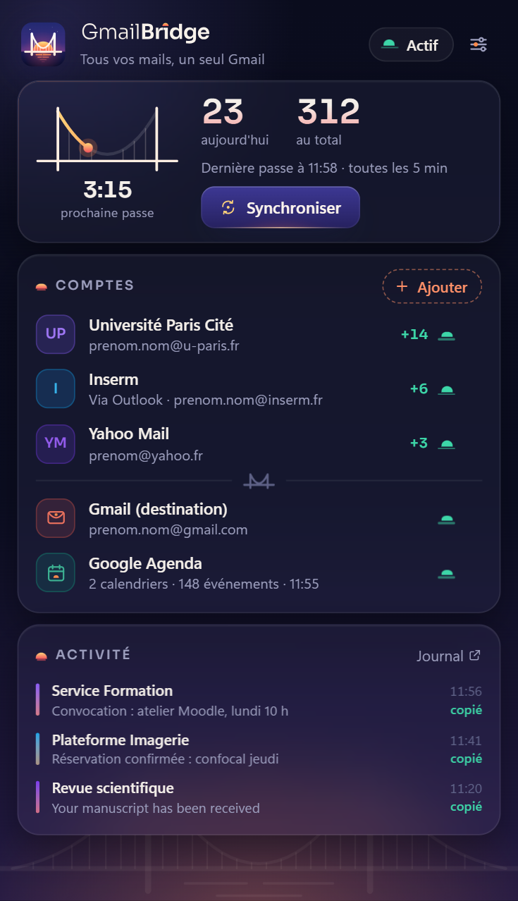
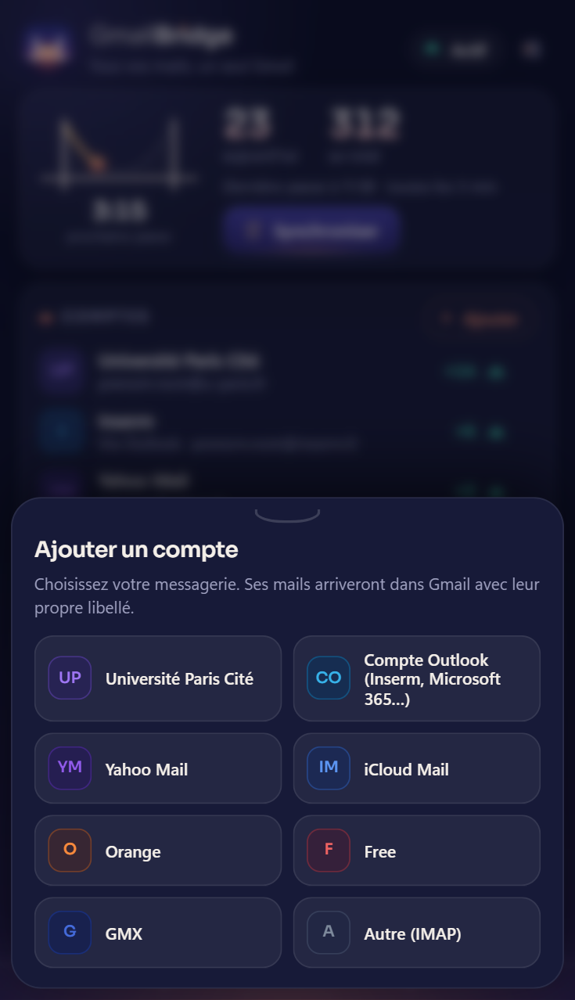
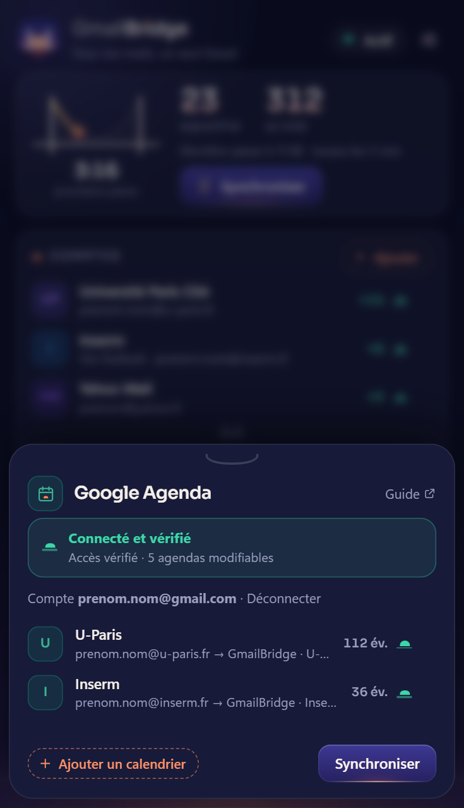
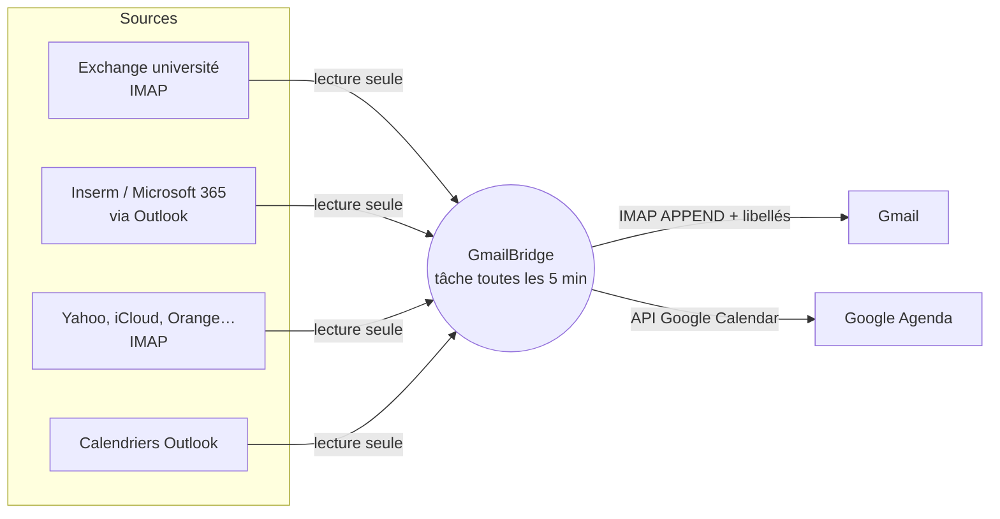

<div align="center">


# GmailBridge

**Tous vos mails et vos agendas, dans un seul Gmail.** <sub>(anciennement MailBridge)</sub>
Université, Inserm / Microsoft 365, Yahoo, iCloud, Orange, Free… copiés dans Gmail, et vos
calendriers Outlook copiés dans Google Agenda. Une petite application Windows, en arrière-plan.

[Installer](#installation-en-un-clic) · [Fonctionnement](#comment-ça-marche) · [Google Agenda](docs/GOOGLE_SETUP.md) · [FAQ](#faq)

&nbsp;&nbsp;
&nbsp;&nbsp;


</div>

## Pourquoi ?

La règle « transférer vers Gmail » d'Outlook / Exchange **perd des mails** : quand un serveur
réexpédie un message venu de l'extérieur, Gmail le rejette (`550 5.7.30 DKIM authentication didn't
pass`), car l'expéditeur d'origine ne correspond plus au serveur qui l'envoie. Sur une boîte
universitaire réelle, environ un message sur deux n'arrivait jamais.

GmailBridge ne transfère pas : il **lit** chaque message à la source puis le **dépose** directement
dans Gmail (IMAP `APPEND`). Un dépôt n'est pas une réception : aucun contrôle SPF / DKIM, rien n'est
rejeté. Expéditeur, date, fil de discussion et pièces jointes sont conservés.

## Fonctionnalités

* **Plusieurs comptes**, chacun avec son libellé Gmail : IMAP (université, Yahoo, iCloud, Orange,
  Free, GMX, autre) ou **Outlook** (Inserm, Microsoft 365, UNIGE… sans mot de passe, via Outlook ouvert).
* **Calendriers** : rendez-vous Outlook copiés dans Google Agenda (création, mise à jour,
  suppression ; récurrences ; événements privés et disponibilité respectés).
* **Aucun doublon** : un message déjà présent dans Gmail (même identifiant, ou même expéditeur,
  objet et heure, car certaines redirections réécrivent l'identifiant) n'est pas recopié.
* **Rattrapage** des 30 derniers jours à l'ajout d'un compte.
* **Arrière-plan** : une tâche Windows à l'ouverture de session puis toutes les 5 minutes, sans
  fenêtre, en priorité basse. Une **icône GmailBridge dans la zone de notification** reste visible
  entre les passes. Fermer l'application n'arrête rien.
* **Sécurité** : lecture seule à la source ; mots de passe dans le Gestionnaire d'identifiants
  Windows, jamais dans un fichier ; aucun serveur tiers, tout se passe entre votre PC et vos comptes.
* **Traçabilité** : chaque message examiné est noté dans un journal CSV (ouvrable dans Excel).

## Installation en un clic

**Windows 10 / 11**, aucun droit administrateur. Dans PowerShell :

```powershell
irm https://raw.githubusercontent.com/Andrianarivelo/MailBridge/main/install.ps1 | iex
```

Ou téléchargez [`Install-GmailBridge.cmd`](Install-GmailBridge.cmd) et double-cliquez dessus.

L'installateur place GmailBridge dans `%LOCALAPPDATA%\Programs\MailBridge`, installe un Python privé
avec [uv](https://github.com/astral-sh/uv) (rien n'est ajouté au système), crée la tâche planifiée et
l'icône **GmailBridge** sur le Bureau, puis ouvre l'application.

L'icône de notification démarre aussi à chaque ouverture de session. Cliquez dessus pour ouvrir
GmailBridge ; un clic droit propose **Synchroniser maintenant**. Son infobulle indique si
l'automatisation est active, en pause ou en erreur, ainsi que la dernière passe.
Windows peut ranger l'icône dans le panneau des icônes masquées (flèche près de l'horloge).

## Premiers pas

1. **Gmail (destination)** : créez un [mot de passe d'application](https://myaccount.google.com/apppasswords)
   (validation en deux étapes requise), puis collez les 16 lettres dans GmailBridge.
2. **Ajouter** vos comptes : choisissez le fournisseur, saisissez identifiant et mot de passe
   (ou, pour Outlook, choisissez le compte). La connexion est testée immédiatement.
3. **Google Agenda** (facultatif) : suivez le [guide de 5 minutes](docs/GOOGLE_SETUP.md), puis
   ajoutez les calendriers Outlook à copier.

| Fournisseur | Mot de passe à utiliser |
|---|---|
| Université Paris Cité (`imap.u-paris.fr`) | mot de passe ENT |
| Inserm, Microsoft 365, UNIGE… (mode Outlook) | aucun : Outlook doit être ouvert |
| Yahoo | mot de passe d'application Yahoo |
| iCloud | mot de passe pour app Apple |
| Orange, Free, GMX | mot de passe de la messagerie (GMX : activer IMAP) |
| Gmail (destination) | mot de passe d'application Google |

## Comment ça marche



Une **passe** : pour chaque compte, on liste les nouveaux messages (progression mémorisée), on
ignore les avis de non-remise, on vérifie qu'ils ne sont pas déjà dans Gmail, on les dépose puis
on pose le libellé du compte. Ensuite, tous les quarts d'heure, on aligne chaque agenda Google
cible sur son calendrier Outlook (seuls les événements copiés par GmailBridge sont modifiés).

```
MailBridge/
├─ GmailBridge.pyw          fenêtre (icône du Bureau)
├─ install.ps1             installation / désinstallation
├─ mailbridge/
│  ├─ engine.py            moteur : comptes -> Gmail, puis agendas (python -m mailbridge.engine)
│  ├─ outlook_source.py    lecture des comptes Outlook (COM)
│  ├─ calendar_sync.py     Outlook -> Google Agenda
│  ├─ gcal.py              OAuth + API Google Calendar (bibliothèque standard)
│  ├─ config.py            comptes, calendriers, réglages (data/config.json)
│  ├─ credentials.py       coffre d'identifiants Windows
│  ├─ ui.py + web/         interface HTML/CSS animée (pywebview + WebView2)
│  ├─ tray.py              icône de notification Windows persistante (pywin32)
│  ├─ background.py        lancement sans console et état de la tâche Windows
│  ├─ web/icons.js         iconographie de l'interface (générée)
│  └─ icon.py              symbole : source unique du SVG et de l'icône .ico (Python pur)
├─ assets/brand/          symbole, logotype, bannière, charte, pictogrammes (SVG)
├─ tools/build_brand.py   génère toute la marque (fontTools, développement seulement)
├─ tests/                  tests hors ligne (faux serveurs IMAP, faux Outlook, faux Google, icône)
└─ data/                   VOS données : config, état, journaux (jamais versionné)
```

## Identité visuelle


Le symbole est un **pont suspendu au lever du soleil**. Les deux pylônes et le câble porteur
(une vraie parabole) dessinent un **M**, celui de Gmail, qui est aussi le rabat d'une enveloppe.
Le tablier sert d'horizon, et le soleil, c'est-à-dire le courrier qui arrive, se lève derrière le pont.
Le logotype est en Sora (licence SIL OFL), avec un détail en signature : le point du « i » de
« Bridge » est ce même soleil.

La même idée sert de **signalétique** dans l'application. Chaque état est un demi-soleil posé
sur l'horizon. Le compte à rebours est un pont que le courrier traverse jusqu'à la prochaine passe.
La poignée des panneaux est un câble en U, et le bouton principal est un ciel de nuit où le soleil
se lève au survol.

Tout est vectoriel, dans [`assets/brand/`](assets/brand) : symbole (détaillé et petites tailles),
logotype et composition (clair / sombre), bannière, pictogrammes et
[charte graphique](assets/brand/gmailbridge-charte.svg). Le symbole n'a qu'une seule source,
`mailbridge/icon.py`, qui écrit à la fois les SVG et l'icône Windows multi-tailles. Pour tout régénérer :

```powershell
uv run --with fonttools python tools/build_brand.py
```

## Réglages

Dans `data/config.json` (section `settings`) : fréquence (`interval_minutes`), rattrapage
(`backfill_days`), délai laissé à une redirection existante (`min_age_minutes`), fenêtre des
agendas (`calendar_past_days`, `calendar_future_days`), fréquence des agendas
(`calendar_interval_minutes`). Ligne de commande :

```powershell
.venv\Scripts\python -m mailbridge.engine --check      # teste Gmail, chaque compte et Google Agenda
.venv\Scripts\python -m mailbridge.engine --dry-run    # simulation (rien n'est écrit)
.venv\Scripts\python -m mailbridge.engine --calendar-only
```

## FAQ

**Le PC doit-il rester allumé ?** Oui, avec votre session ouverte. Ce qui arrive pendant qu'il est
éteint est rattrapé à la passe suivante.

**Pourquoi le mode Outlook pour Microsoft 365 ?** Microsoft a désactivé la connexion IMAP par mot de
passe sur Microsoft 365. Outlook, déjà connecté, sert de source : aucun mot de passe à donner.

**Pourquoi un accès Google à créer pour l'agenda ?** Google Agenda refuse les mots de passe
d'application. Chaque utilisateur crée son propre accès OAuth (gratuit, 5 minutes) : voir
[le guide](docs/GOOGLE_SETUP.md).

**Combien de ressources ?** En arrière-plan, une passe dure quelques secondes puis le processus se
ferme. L'icône reste présente dans un petit processus séparé, sans WebView, même lorsque la fenêtre
est fermée. La fenêtre utilise le moteur Edge WebView2 : environ 2 s pour s'ouvrir et quelques
centaines de Mo tant qu'elle est ouverte. Fermez-la, rien ne s'arrête.

**Masquer l'icône arrête-t-il la synchronisation ?** Non. Le menu **Masquer l'icône (synchro maintenue)**
ferme uniquement l'indicateur. Rouvrir GmailBridge le réaffiche. Pour suspendre les passes automatiques,
utilisez le réglage de démarrage automatique dans GmailBridge ; l'infobulle indique alors la pause.

**Est-ce autorisé par mon établissement ?** Copier du courrier professionnel vers un compte
personnel peut être encadré par la charte informatique de votre établissement (RGPD, données
d'étudiants). Vérifiez-la avant usage.

**Désinstaller ?** [`Uninstall-GmailBridge.cmd`](Uninstall-GmailBridge.cmd) retire les deux tâches et les
icônes (vos réglages, journaux et identifiants sont conservés ; supprimez le dossier pour tout effacer).

## Développement

```powershell
uv venv .venv --python 3.12 ; uv pip install --python .venv\Scripts\python.exe -r requirements.txt
.venv\Scripts\python -m unittest discover -s tests -v
.venv\Scripts\python GmailBridge.pyw --demo        # interface avec des données fictives
```

## English summary

GmailBridge is a small Windows app that gathers several mailboxes (university Exchange over IMAP,
Microsoft 365 through the local Outlook client, Yahoo, iCloud…) into one Gmail inbox by reading each
message at the source and appending it to Gmail over IMAP, which avoids the SPF/DKIM rejections
that break server-side forwarding. It also mirrors Outlook calendars into Google Calendar (OAuth,
one-way, tagged events only). One-click install, runs in the background, MIT licensed.

## Licence

[MIT](LICENSE)
