<div align="center">

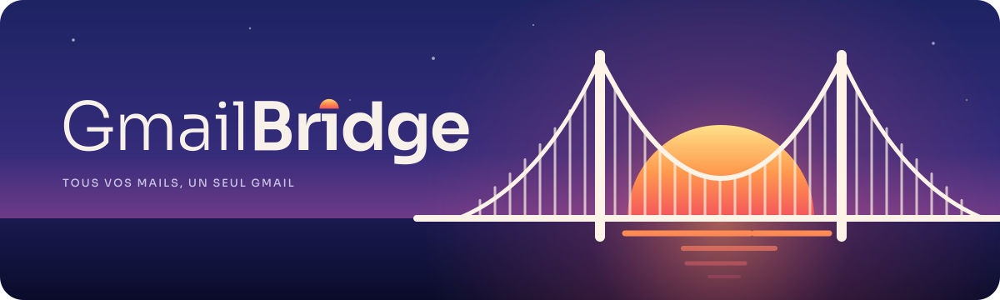

# GmailBridge

**All your inboxes and calendars, in one Gmail.** 🌅
<sub>(formerly MailBridge)</sub>

University, Inserm / Microsoft 365, Yahoo, iCloud, Orange, Free… all landing in Gmail, plus your
Outlook calendars copied into Google Calendar. A small Windows app that quietly does its job in the background.

[](https://github.com/Andrianarivelo/MailBridge/releases/latest)


[](LICENSE)

[Install](#-install-in-30-seconds) · [Tour](#-a-three-minute-tour) · [Google Calendar](#-google-calendar-in-5-minutes) · [How it works](#%EF%B8%8F-how-it-works) · [FAQ](#-faq)

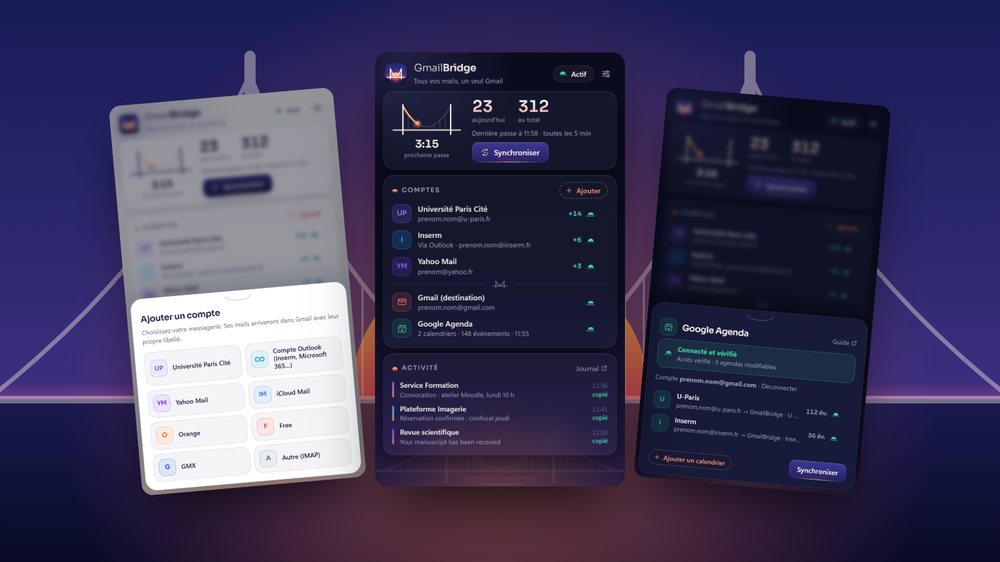

</div>

## 🤔 Why does this exist?

You told Outlook / Exchange to "forward everything to Gmail". Sounds simple. Except Gmail politely
**bounces about half of it** (`550 5.7.30 DKIM authentication didn't pass`): when a server re-sends a
message that came from someone else, the signatures no longer match, and Gmail assumes it's fishy.
On a real university mailbox, **one message in two never arrived**. Ouch. 🕳️📬

GmailBridge doesn't forward. It **reads** each message at the source and **drops** it straight into
your Gmail (IMAP `APPEND`). Dropping is not receiving: no SPF / DKIM check, nothing gets rejected.
Sender, date, thread and attachments all arrive exactly as they left.

## ✨ What it does

* 📥 **Many inboxes, one Gmail.** Each account gets its own Gmail label. IMAP (university, Yahoo,
  iCloud, Orange, Free, GMX, anything else) or **Outlook mode** (Inserm, Microsoft 365, UNIGE…):
  no password needed, it reads through the Outlook already open on your PC.
* 📅 **Calendars too.** Outlook appointments are copied into Google Calendar: new, changed and deleted
  events, recurrences, private events and busy / free status included.
* 🧹 **No duplicates.** A message already in Gmail (same ID, or same sender + subject + time, because
  some redirects rewrite IDs) is never copied twice.
* ⏪ **Catch-up.** When you add an account, the last 30 days come along too.
* 🌙 **Background mode.** A Windows task runs at sign-in, then every 5 minutes, at low priority and
  with no window. A tray icon shows that all is well. Closing the app stops nothing.
* 🔒 **Safe by design.** Read-only at the source, passwords in the Windows Credential Manager (never in a
  file), and no third-party server: just your PC talking to your own accounts.
* 🧾 **Receipts.** Every message examined is logged in a CSV journal (opens in Excel).

## 🚀 Install in 30 seconds

**Windows 10 / 11**, no admin rights needed. Open PowerShell and paste:

```powershell
irm https://raw.githubusercontent.com/Andrianarivelo/MailBridge/main/install.ps1 | iex
```

Prefer clicking? Grab the zip from the [latest release](https://github.com/Andrianarivelo/MailBridge/releases/latest),
unzip it anywhere, then double-click **`Install-GmailBridge.cmd`**. ☕ That's it.

The installer sets up a private Python with [uv](https://github.com/astral-sh/uv) (nothing touches your
system), creates the background task, adds a **GmailBridge** icon to your Desktop and Start menu, then
opens the app. To remove it all, run **`Uninstall-GmailBridge.cmd`** (your settings and passwords stay put).

> 🇫🇷 **Heads-up:** the app itself speaks French for now (it was born in a Paris lab). The screenshots
> below come with English captions, and there's a [tiny phrasebook](#-french-phrasebook) further down.

## 🧭 A three-minute tour

All screenshots come from the built-in demo mode, so the names and addresses are made up.

<table>
<tr>
<td width="50%" align="center">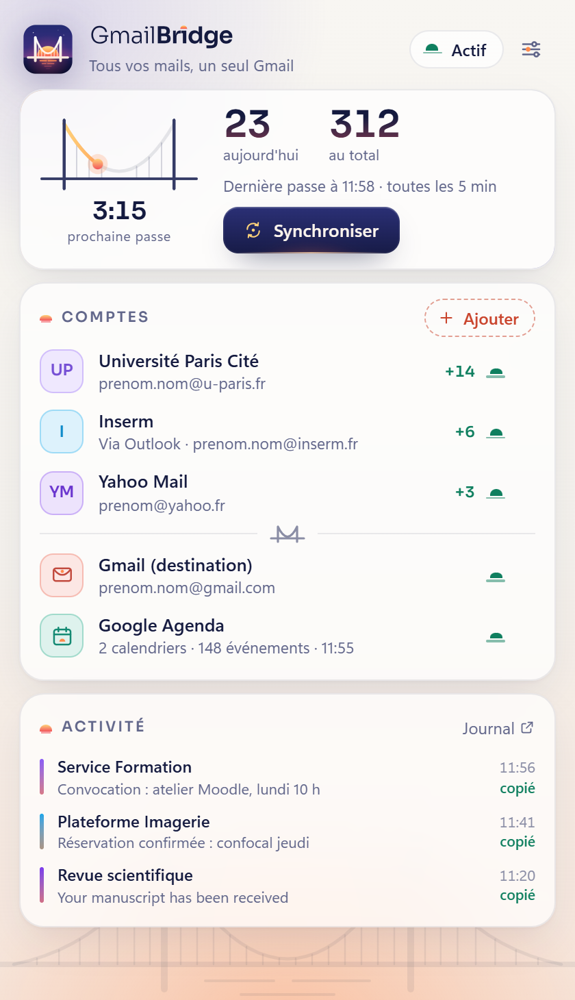</td>
<td width="50%" align="center">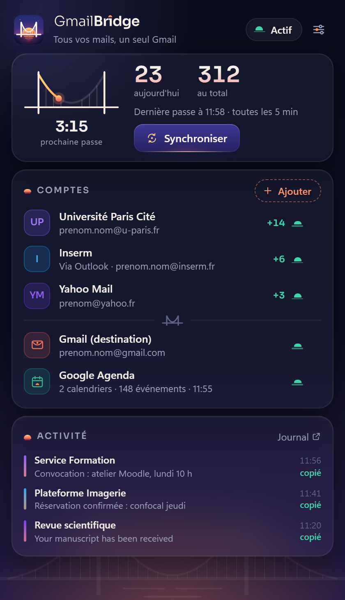</td>
</tr>
<tr><td colspan="2">

**1. Meet the dashboard.** The little bridge is the countdown: the sun (your mail 🌞) travels along
the cable and the next sync happens when it reaches the far tower. Below it: messages copied today and
in total, your accounts with today's catch, and where everything ends up (Gmail + Google Calendar).
Each status light is a tiny sun on the horizon: green means all good. It follows Windows' light or dark theme.

</td></tr>
<tr>
<td align="center">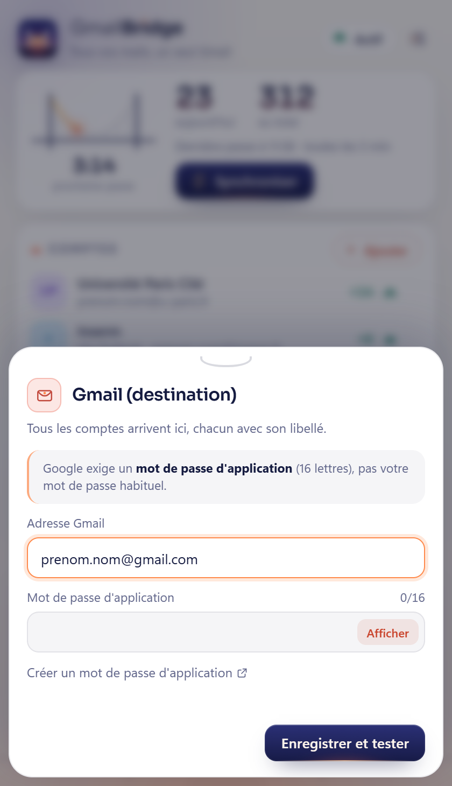</td>
<td>

**2. Tell it where to deliver.** Click **Gmail (destination)**, type your Gmail address and paste a
Google [app password](https://myaccount.google.com/apppasswords) (16 letters, needs 2-step
verification). The little counter turns green at 16/16. Click **Save and test** and you're done.

</td></tr>
<tr>
<td align="center">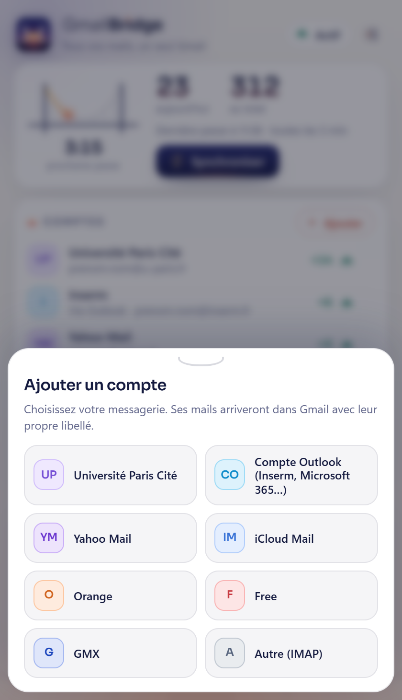</td>
<td align="center">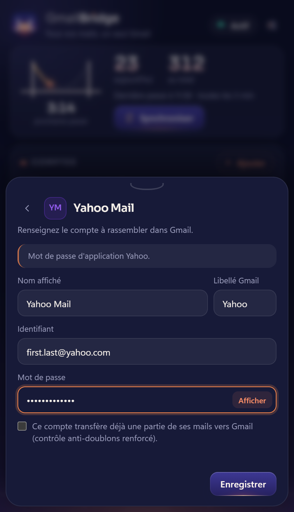</td>
</tr>
<tr><td colspan="2">

**3. Add your inboxes.** Hit the dashed **+ Add** (« Ajouter ») button and pick your provider. Fill in
the login, and GmailBridge tests the connection right away. Pick the Gmail label you like (U-Paris,
Yahoo, Work…). For Outlook-mode accounts there's nothing to type: just choose the account in the list.

</td></tr>
<tr>
<td align="center">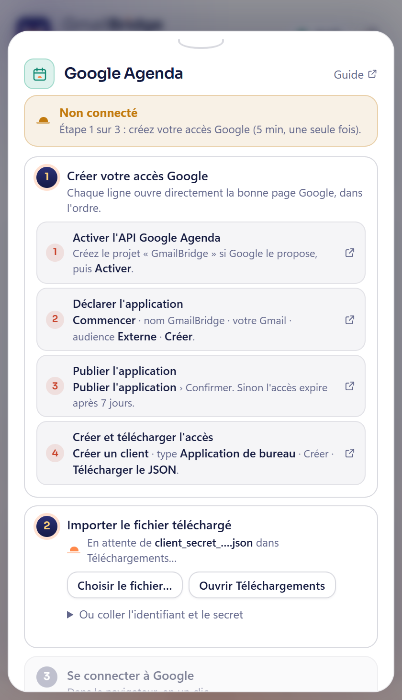</td>
<td align="center">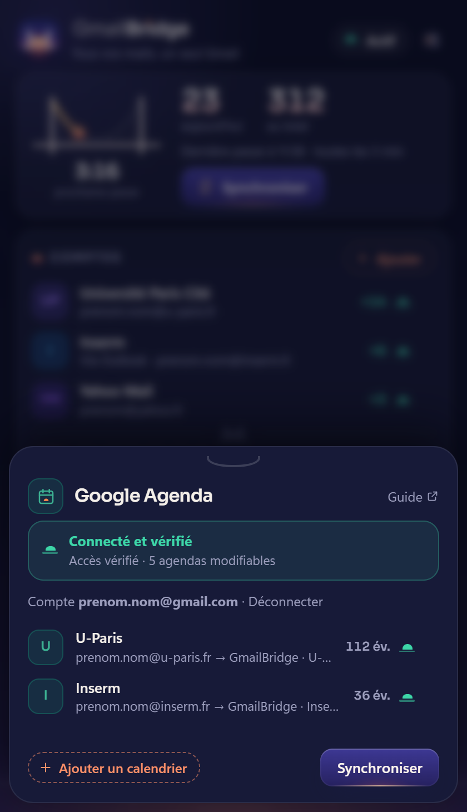</td>
</tr>
<tr><td colspan="2">

**4. Calendars, if you want them (optional).** The Google Calendar panel is a step-by-step wizard:
every line opens the exact Google page and says what to click. It even spots the downloaded
`client_secret_….json` in your Downloads folder and imports it by itself. Once connected, it
**actually tests** the access (« Connecté et vérifié ») and lists the Outlook calendars being mirrored.

</td></tr>
<tr>
<td align="center">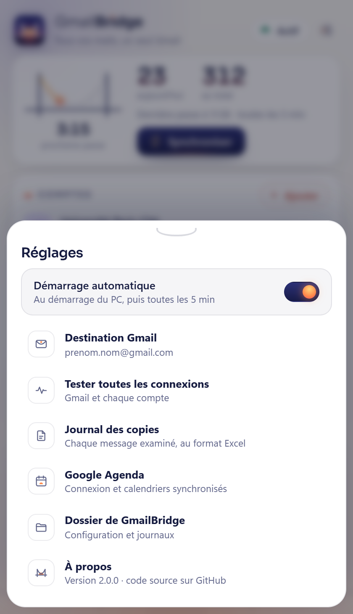</td>
<td align="center">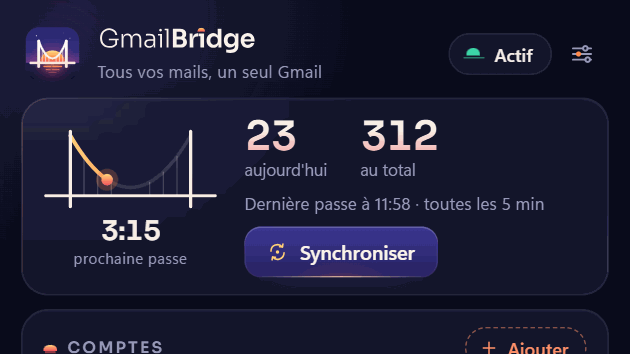</td>
</tr>
<tr><td colspan="2">

**5. Settings, and the fun button.** In settings (the sliders icon, top right): automatic start (the
switch's sun rises when it's on 🌅), a test of every connection, the journal, the data folder. Feeling
impatient? Hover **Synchroniser**: a sun rises under the button. Click it: letters stream across the
bridge, then a toast tells you how many messages were copied.

</td></tr>
</table>

### 🇫🇷 French phrasebook

| On screen | Means |
|---|---|
| Synchroniser | Sync now |
| prochaine passe | next run |
| aujourd'hui · au total | today · in total |
| Comptes · Ajouter | Accounts · Add |
| Activité · copié | Activity · copied |
| Actif · En cours · À vérifier · En pause | Active · Running · Needs a look · Paused |
| Réglages · Démarrage automatique | Settings · Start automatically |
| Mot de passe d'application | App password |
| Enregistrer et tester | Save and test |

### 🔑 Which password goes where?

| Provider | Password to use |
|---|---|
| Université Paris Cité (`imap.u-paris.fr`) | your ENT password |
| Inserm, Microsoft 365, UNIGE… (Outlook mode) | none: just keep Outlook open |
| Yahoo | a Yahoo app password |
| iCloud | an Apple app-specific password |
| Orange, Free, GMX | your webmail password (GMX: switch IMAP on) |
| Gmail (destination) | a Google app password |

## 📅 Google Calendar in 5 minutes

Google Calendar doesn't accept app passwords, so everyone creates their **own** free OAuth access (it
belongs to you, nobody else can use it). The wizard in the app walks you through it; here's the gist:

1. [Enable the Google Calendar API](https://console.cloud.google.com/flows/enableapi?apiid=calendar-json.googleapis.com)
   (create a project called `GmailBridge` if asked).
2. [Declare the app](https://console.developers.google.com/auth/branding): name `GmailBridge`, your Gmail, audience **External**.
3. [Publish it](https://console.developers.google.com/auth/audience), otherwise access expires after 7 days.
4. [Create a client](https://console.developers.google.com/auth/clients) of type **Desktop app** and **download the JSON**.
   GmailBridge picks it up from your Downloads folder on its own. 🪄
5. Click **Se connecter à Google** (sign in). Google says "this app isn't verified": that's expected, it's
   *your* app. Click **Advanced** › **Go to GmailBridge** › tick Google Calendar › **Continue**.

The full guide (in French) lives in [docs/GOOGLE_SETUP.md](docs/GOOGLE_SETUP.md).

## ⚙️ How it works

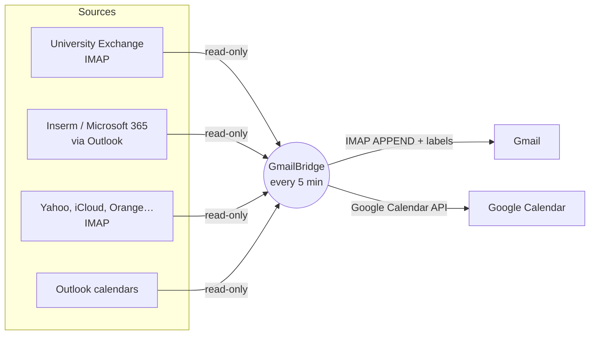

One **run**, for each account: list the new messages (progress is remembered), skip bounce
notices, check they're not already in Gmail, drop them in, apply the label. Every quarter of an hour,
each target Google calendar is lined up with its Outlook calendar (only events GmailBridge created are
ever touched).

```
MailBridge/
├─ GmailBridge.pyw         the window (Desktop icon)
├─ install.ps1             install / uninstall
├─ mailbridge/
│  ├─ engine.py            the engine: accounts -> Gmail, then calendars
│  ├─ outlook_source.py    reads Outlook accounts (COM)
│  ├─ calendar_sync.py     Outlook -> Google Calendar
│  ├─ gcal.py              OAuth + Google Calendar API (standard library only)
│  ├─ config.py            accounts, calendars, settings (data/config.json)
│  ├─ credentials.py       Windows Credential Manager
│  ├─ ui.py + web/         HTML/CSS interface (pywebview + WebView2)
│  ├─ tray.py              tray icon (pywin32)
│  ├─ background.py        console-free launching and task status
│  └─ icon.py              the logo, single source for the SVG and the .ico (pure Python)
├─ assets/brand/           logo, wordmark, banner, brand sheet, icons (SVG)
├─ tools/                  brand, screenshot and release builders (dev only)
├─ tests/                  offline tests (fake IMAP servers, fake Outlook, fake Google)
└─ data/                   YOUR data: config, state, logs (never committed)
```

## 🔒 Your data stays yours

* **Read-only** at the source: GmailBridge never deletes or changes anything in your original mailboxes.
* **Passwords** live in the Windows Credential Manager, never in a file and never in the logs.
* **No cloud of ours**: there's no GmailBridge server. Your PC talks to your accounts, period.
* **Calendar access** is your own OAuth client, revocable at any time in your
  [Google account](https://myaccount.google.com/permissions) or with **Déconnecter** (disconnect) in the app.

## 🎨 The look

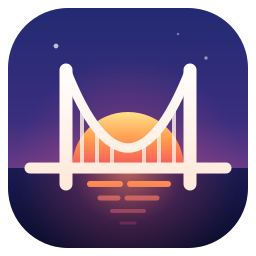

The logo is a **suspension bridge at sunrise**. The two towers and the cable (a real parabola) draw
an **M** for Gmail, which is also an envelope flap. The deck is the horizon, and the rising sun is your
mail arriving. In the wordmark, the dot on the "i" of *Bridge* is that same sun. The whole app reuses
the idea: status lights are little suns, the countdown is a bridge, and the main button is a night sky
where the sun rises on hover. Everything is vector and generated from code: see the
[brand sheet](assets/brand/gmailbridge-charte.svg) and [assets/brand](assets/brand).

## ❓ FAQ

**Does my PC need to stay on?** Yes, with your session open. Anything that arrives while it's off is
picked up on the next run. Nothing is lost.

**Why "Outlook mode" for Microsoft 365?** Microsoft switched off password-based IMAP for Microsoft 365.
Outlook is already signed in, so GmailBridge simply reads through it: no password to hand over.

**How heavy is it?** In the background, a run takes a few seconds and then the process exits. The tray
icon is a tiny separate process without any web view. The window uses Edge WebView2: about 2 s to open
and a few hundred MB while it's open. Close it: nothing stops.

**Does hiding the tray icon stop syncing?** No. **Masquer l'icône (synchro maintenue)** only hides the
indicator. To pause the automatic runs, turn off automatic start in the settings.

**Is it OK with my institution?** Copying work mail to a personal account can be covered by your
institution's IT policy (GDPR, student data…). Have a quick look before using it.

**I knew it as MailBridge!** Same app, new name and new look since 3.0. Your settings, passwords and
background tasks carry over untouched.

## 🧑‍💻 For developers

```powershell
uv venv .venv --python 3.12 ; uv pip install --python .venv\Scripts\python.exe -r requirements.txt
.venv\Scripts\python -m unittest discover -s tests -v          # 60 offline tests
.venv\Scripts\python GmailBridge.pyw --demo                    # the UI with fake data
uv run --with fonttools python tools/build_brand.py            # rebuild logo, icons, brand sheet
uv run --with playwright --with pillow python tools/make_screenshots.py   # README screenshots (uses installed Chrome)
.venv\Scripts\python tools/build_release.py                    # tests + checks + release zip in dist/
```

## ⚖️ License & fine print

[MIT](LICENSE). The Sora typeface is under the SIL Open Font License (see `mailbridge/web/fonts/OFL.txt`).

GmailBridge is an independent personal project, **not affiliated with, endorsed or sponsored by Google**.
Gmail and Google Calendar are trademarks of Google LLC; Outlook and Microsoft 365 are trademarks of Microsoft.
